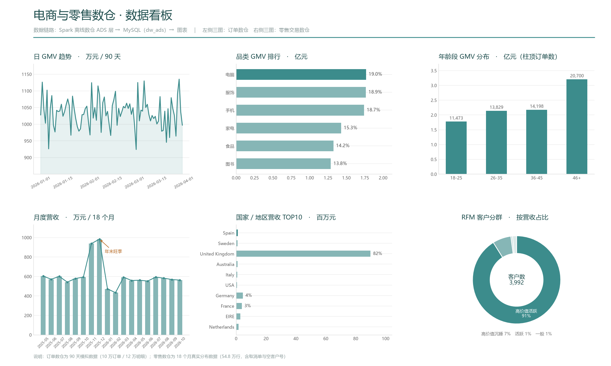

# 电商与零售离线数仓（Spark + Docker）

基于 Apache Spark 3.5 的离线数据仓库实践：按 **ODS → DWD → DWS → ADS** 四层建模，
覆盖分区设计、增量处理、数据倾斜调优、任务调度与可视化。



## 1. 做了什么

| 能力 | 实现 | 可验证的结果 |
|---|---|---|
| 四层数仓 | 5 张源表 → 12 万行明细宽表 → 3 张汇总表 → 4 张报表 | 90 个日期分区 |
| 增量处理 | `partitionOverwriteMode=dynamic`，只覆盖当天分区 | 单日 **7.5 秒** vs 全量 19.3 秒 |
| 数据倾斜 | 构造 90% 热点 → 定位 → 加盐两阶段聚合 | 最大分区占比 **91.2% → 37.0%** |
| 真实规模数据 | 54.8 万行零售交易，含取消单/负数量/空客户号 | 清洗后 52.96 万行，产出 RFM |
| 调度 | cron 每日 02:00 + 日志轮转 | 单次执行 8.2 秒，返回码 0 |
| 可视化 | ADS 同步 MySQL → matplotlib 六宫格 | 6 张图，PNG 直出 |

## 2. 架构

```
数据源 CSV ──► ODS（原样入湖，按 order_date 分区）
                 │ 5 表 join（事实 + 维度）
                 ▼
             DWD（明细宽表：decimal 金额、年龄段维度）
                 │ 按维度聚合
                 ▼
             DWS（品类×日 / 用户×日 / 年龄段×日）
                 │ 业务口径
                 ▼
             ADS（GMV·UV / 品类占比 / 年龄分布 / RFM）
                 │ 同步 MySQL
                 ▼
             可视化看板
```

血缘图见 `docs/lineage.png`，完整项目复盘见 `docs/项目复盘.docx`。

## 3. 快速开始

```bash
# 1. 依赖
pip install pyspark==3.5.3 pandas matplotlib pymysql sqlalchemy
# 需要 JDK 17：export JAVA_HOME=/usr/lib/jvm/java-17-openjdk-amd64

# 2. 起 MySQL 与 MinIO（可选，仅 BI 与对象存储需要）
docker compose up -d

# 3. 生成模拟业务数据（10 万订单 / 20 万明细）
python jobs/gen_data.py

# 4. 全量构建四层数仓（约 19 秒）
python jobs/etl_full_v2.py

# 5. 按日增量（只处理指定日期）
python jobs/etl_incr.py 2026-01-15

# 6. 数据倾斜实验
python jobs/skew_demo.py

# 7. 真实规模数据（54.8 万行）+ RFM
python jobs/gen_realistic.py
python jobs/etl_real.py

# 8. 同步到 MySQL 并出看板
python jobs/prep_bi.py
python jobs/dashboard.py
```

## 4. 目录

```
.
├─ jobs/
│  ├─ gen_data.py        生成 5 张业务表
│  ├─ etl_full_v2.py     v2 全量构建（decimal 金额 + 年龄段）
│  ├─ etl_incr.py        按日增量 + 动态分区覆盖
│  ├─ skew_demo.py       倾斜实验（分区行数 + 加盐）
│  ├─ gen_realistic.py   生成真实分布零售数据
│  ├─ etl_real.py        零售数据 ETL + RFM
│  ├─ chk_v2.py          结果校验
│  ├─ prep_bi.py         ADS → MySQL
│  └─ dashboard.py       看板出图
├─ scripts/run_daily.sh  每日调度脚本（cron 调用）
├─ docs/                 看板图、血缘图、项目复盘
└─ docker-compose.yml    MySQL + MinIO
```

## 5. 关键设计说明

**为什么分四层**：ODS 只做留存不改数据；DWD 统一清洗与打平，只保留支付成功订单；
DWS 预聚合避免重复扫描明细；ADS 面向业务口径，出问题能逐层回溯。

**金额为什么用 decimal**：Spark 的 `double` 在展示时输出 `1.028E7` 科学计数法，
且浮点累加有精度误差，报表层统一 `decimal(12,2)`。

**增量怎么保证不重复写**：开启动态分区覆盖后，`write.mode("overwrite")` 只替换
本次写到的分区；验证方式是比对分区目录时间戳与总行数（90 个分区不变、12 万行不变）。

**倾斜为什么不靠调参解决**：倾斜是数据分布问题，加盐把热点 key 拆成多个子 key
并行处理后合并，比调 `shuffle.partitions` 更根本。

## 6. 数据质量与 Hive 外表

**数据质量**（`jobs/check_quality.py`）：五条断言覆盖完整性、唯一性、有效性、时效性、一致性，
任一失败即 `sys.exit(1)`，调度层可据此阻断下游。

```
[PASS] 完整性  ODS 100,000 行 vs 源文件 100,000 行
[PASS] 唯一性  总行数 120,322 vs 主键去重 120,322（重复 0）
[PASS] 有效性  金额<=0 共 0 行；金额与 数量×单价 不一致 0 行
[PASS] 时效性  分区 90 个，单日行数 1229~1468，空分区 0 个
[PASS] 一致性  总行数 120,322 vs 基线 120,322（偏差 0.00%）
```

**Hive 外表**（`hive/hive_ddl.py`）：用 Spark 内置 Hive 支持（Derby 元数据库）跑真实 DDL，
把已有 parquet 目录注册成外部分区表：

```sql
CREATE EXTERNAL TABLE dwd_order_detail_ext (
  order_id INT, item_id INT, user_id INT, product_id INT,
  category STRING, region_name STRING, order_status STRING,
  quantity INT, unit_price DOUBLE, amount DECIMAL(12,2), age_group STRING
)
PARTITIONED BY (order_date STRING)
STORED AS PARQUET
LOCATION '/home/data/bigdata/jobs/warehouse_v2/dwd_order_detail';

MSCK REPAIR TABLE dwd_order_detail_ext;   -- 自动登记 90 个分区
```

验证结果：建表后分区为空 → REPAIR 后 90 个分区；查询计划出现
`PartitionFilters: [(order_date = 2026-01-15)]` 说明分区裁剪生效；
`DROP TABLE` 前后数据目录文件数均为 362，印证「外部表只删元数据、不删数据」。

## 7. 已知限制

- 模拟业务数据为均匀随机分布，品类占比接近 18%；真实零售数据（`etl_real.py`）才体现长尾。
- 运行在 local 模式，未验证 YARN/K8s 提交；多任务依赖调度未接入（可用 DolphinScheduler 替换 cron）。
- 零售数据集为「UCI Online Retail schema 的同分布合成数据」：公开数据集下载受限（约 10 KB/s
  且不支持断点续传，30 分钟未取到完整包），故用幂律分布 + 季节波动模拟，ETL 可直接切真实文件。
